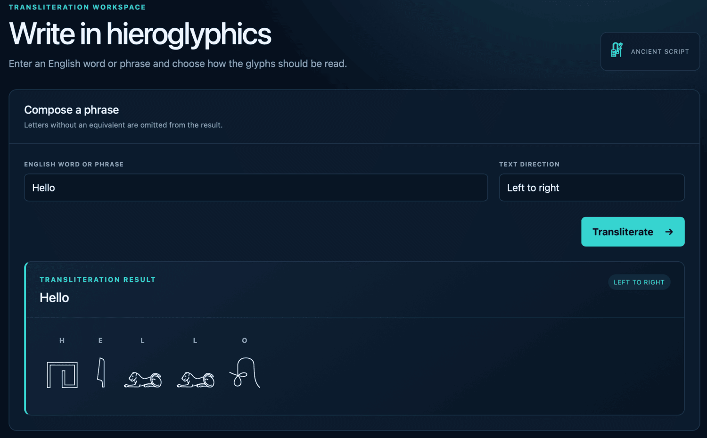
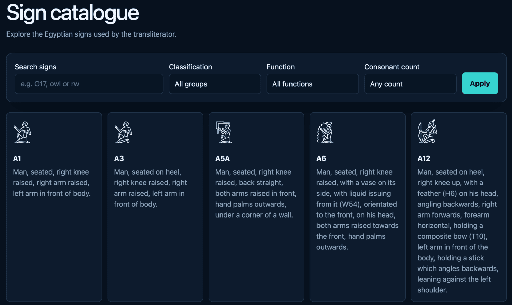
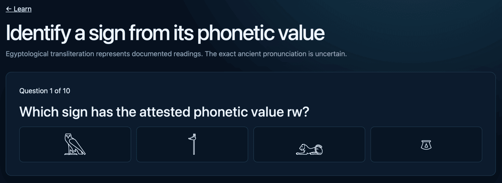
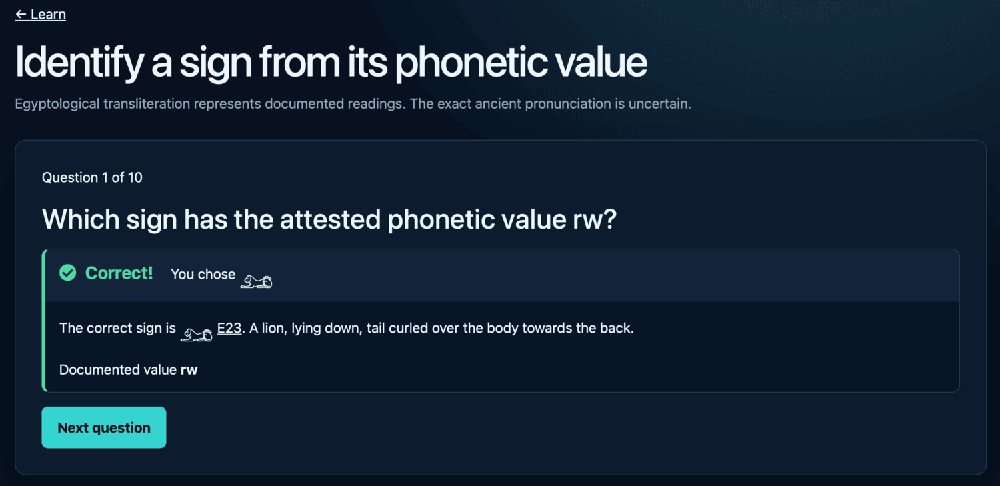

[](https://github.com/davewalker5/Hieroglyphics/actions)
[](https://codecov.io/gh/davewalker5/Hieroglyphics)
[](https://github.com/davewalker5/Hieroglyphics/issues)
[](https://github.com/davewalker5/Hieroglyphics/releases)
[](https://github.com/davewalker5/Hieroglyphics/blob/main/LICENSE)
[](https://www.python.org)
[](https://github.com/davewalker5/Hieroglyphics/)

# Hieroglyphics – Exploring Ancient Egyptian Writing

_Hieroglyphics_ is an application for exploring ancient Egyptian hieroglyphic writing through transliteration, sign exploration and interactive learning and is intended for anyone with an interest in Egyptian hieroglyphs, from those encountering them for the first time to those wishing to learn a little about individual signs and their characteristics.

It is not intended to provide a comprehensive course in ancient Egyptian or to replace established Egyptological reference works.

## Transliteration

_Transliteration_ attempts to represent the text of one language in the writing system of another. The transliteration page provides an introduction to hieroglyphic signs, allowing users to enter English words and phrases and experiment with their hieroglyphic representations, implementing a simplified modern transliteration based on application-specific character correspondences, rather than a translation of English into ancient Egyptian.



## The Sign Catalogue

The sign catalogue provides a means of investigating individual hieroglyphs beyond the simplified correspondences used by the transliterator. Depending on the information available for a particular sign, the catalogue provides access to:

- Gardiner identifiers and sign classifications
- Descriptions of the objects depicted by signs
- Attested phonetic values expressed using conventional Egyptological transliteration
- Documented linguistic functions
- Supporting examples and historical reference information where available

The catalogue allows you to review what a sign looks like, what it represents phonetically and the roles it can perform within written language. It also provides an opportunity to discover aspects of ancient Egyptian material culture and the natural world through the objects depicted by hieroglyphs.



The catalogue draws its information from [Unikemet](https://www.unicode.org/reports/tr57/), the Unicode Egyptian Hieroglyph Database maintained by the Unicode Consortium. In addition to the Unicode representation of individual hieroglyphs, this resource provides supplementary information concerning sign descriptions, classifications, linguistic functions, phonetic values and references to established hieroglyphic sign inventories.

A version-specific snapshot of the Unikemet dataset, along with its associated licensing information, is retained in the _data_ folder of the repository. The applications own catalogue is a subset that's generated from this snapshot and the resulting snapshot is packaged with the application, again alongside a copy of the UniKemet license.

## Learning Exercises

The interactive learning exercises consist of a set of short, scored quizzes aiming to encourage learning through repetition:

| Exercise                                                      | Intended Outcome                                                                                                                                                      |
| ------------------------------------------------------------- | --------------------------------------------------------------------------------------------------------------------------------------------------------------------- |
| Identify a Sign from its Phonetic Value                       | Develop the ability to associate conventional Egyptological transliteration with individual hieroglyphic signs.                                                       |
| Identify the Phonetic Value of a Displayed Sign               | Develop visual recognition of hieroglyphic signs and recall their historically attested phonetic values.                                                              |
| Identify the Object Depicted by a Sign                        | Develop familiarity with the visual characteristics of hieroglyphs and the animals, plants, objects and aspects of ancient Egyptian life they depict.                 |
| Identify the Gardiner Classification of a Sign                | Understand how hieroglyphic signs are organised within Gardiner's classification system, supporting navigation of sign catalogues and Egyptological reference works.  |
| Distinguish Between Different Linguistic Functions            | Understand the different roles performed by hieroglyphic signs as phonograms, logograms and determinatives, recognising that their functions may depend upon context. |
| Recognise Uniliteral, Biliteral and Triliteral Phonograms     | Understand how individual hieroglyphic signs can represent multiple consonants and why Egyptian hieroglyphic writing is more complex than a simple alphabet.          |
| Determine the Reading Direction of a Hieroglyphic Inscription | Develop familiarity with the directional conventions of Egyptian hieroglyphic writing and the visual clues used to establish reading order.                           |





## Running the Application

### Pre-requisites

To run the application, create and activate a virtual environment, then install the project:

    python -m pip install -e .

### Running the Web Application

To run the web-based application in the Flask development web server, enter the following from the root of the working copy of the project:

    export PYTHONPATH=`pwd`/src
    export FLASK_DEBUG=1
    python -m hieroglyphics

The environment commands may need to be modified based on the current operating system. Once the development server is running, browse to the following URL in a web browser:

    http://127.0.0.1:5000/

## Documentation

Comprehensive project documentation is maintained alongside the application source code in the `docs` directory using Sphinx. The README provides an introduction and quick-start instructions; the Sphinx documentation is the principal source of detailed project documentation.

### Generating Documentation

To generate the documentation, install the documentation dependencies:

    python -m pip install -e ".[docs]"

HTML documentation can then be created by running the following commands from the "docs" sub-folder:

    export PYTHONPATH=`pwd`/../src/
    make html

The resulting documentation is written to the docs/build/html folder and can be viewed by opening "index.html" in a web browser.

## Project Structure

| Package                       | Contents                                       |
| ----------------------------- | ---------------------------------------------- |
| hieroglyphics.catalogue       | Catalogue data and data management             |
| hieroglyphics.learning        | Learning exercise classes and logic            |
| hieroglyphics.transliteration | Transliteration logic                          |
| hieroglyphics.web             | Flask-based web application and user interface |

## Unit Tests and Coverage

To run the unit tests, install the project's development and test dependencies:

```bash
python -m pip install -e ".[test]"
python -m pip install -e ".[dev]"
```

The tests can then be run from the command line, at the root of the project folder, as follows:

```bash
python -m pytest
```

Similarly, a coverage report can be generated by running the following commands from the root of the project folder:

```bash
python -m pytest --cov=src --cov-branch --cov-report html
```

This will create a folder "htmlcov" containing the coverage report in HTML format.

## License

This project is licensed under the MIT License — see the [LICENSE](LICENSE) file for details.
